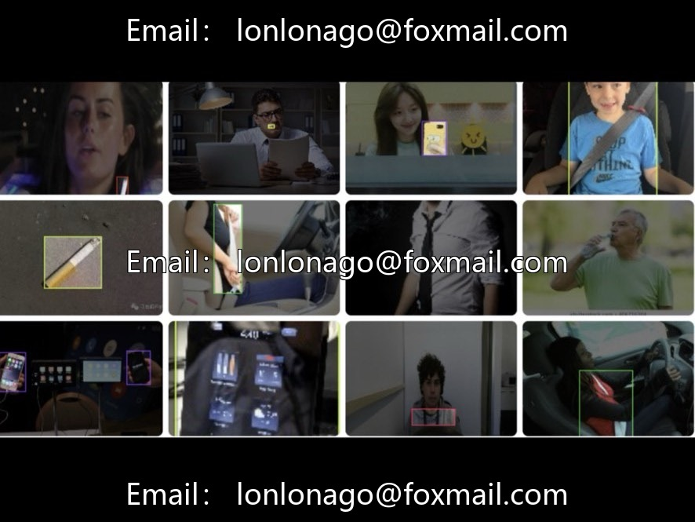
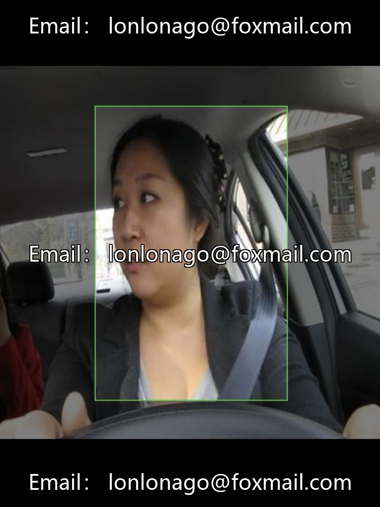

# In-car driving violation detection dataset, issue 10775, 28284 real-time photos in both day and night

## Body

In-car driving violation detection dataset, issue 10775, 28284 real-time images captured in both day and night, covering interior and high-altitude checkpoints from dual perspectives. Four types of annotations: holding a mobile phone, smoking, fastening seatbelt, not fastening seatbelt. Full coverage of complex conditions, including window reflections, human body obstructions, daylight and darkness, and tiny mobile phone targets. Supports multiple formats (YOLO/VOC/COCO), comes with pre-trained models, baseline mAP@50=87.2%, precision=88.8%, recall=89.8%. Comprehensive Python code for YOLOv8 lightweight 26-round training + inference is provided, ready for one-click execution.

The dataset is labeled cleanly, eliminating completely occluded and overexposed invalid samples. It synchronizes recognition of multiple high-risk violations, adapts to small target detection, and balances academic experiments with the implementation in traffic law enforcement.

Four major application landings: 1. Automated capture of violations and evidence collection by road electronic card points; 2. Operational vehicle monitoring, including DMS safety monitoring for ride-hailing/buses; 3. High-speed toll station AI terminal, real-time identification and warning of driving behavior; 4. Digital road management, assisting in off-site law enforcement, reducing the cost of manual patrols

Adaptation Direction: Intelligent Transportation, Driver Behavior Recognition, YOLO Multi-Object Detection, Traffic AI Thesis, In-Vehicle Monitoring System Development.

Virtual materials, once sold, are non-refundable.
Interested friends, click "I want" to proceed.

## Images

## Payment

Here is a pay link on Stripe ( https://buy.stripe.com/3cs8yP7sY87d0vu9AB ). Please contact me lonlonago@foxmail.com after funding $89, and I will send you a complete data files , thank you!

